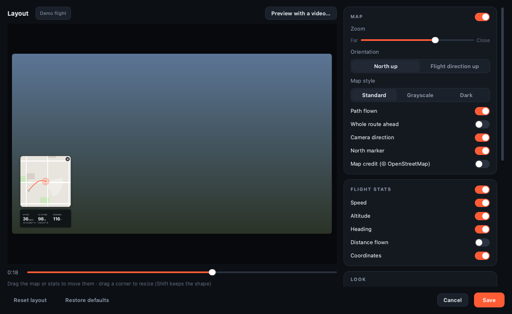

# Drone Map Overlay

Drop in a drone video, get back a copy with a **live map** and **flight stats**
(speed, altitude, heading, distance, coordinates) burned in. Works on Windows,
macOS and Linux.




## Features

- **No extra files needed for recent DJI drones.** GPS is read from the telemetry DJI
  embeds inside the MP4 (tested on the Mini 5 Pro). Older DJI drones work too if you
  recorded with **Video Subtitles / Captions** turned on (the `.SRT` file next to the video).
- **Live mini-map** that follows the drone, in four styles: **Light** and **Dark**
  (grayscale), **Color** (the standard map) and **Satellite**. On first launch the map
  matches your computer: white in light mode, black in dark mode.
- **Make it yours:** rounded or circular map, north-up or direction-of-flight-up, whole
  flight / recent / no trail, arrow or dot marker, camera direction, route ahead, north
  marker, border, opacity, drop shadow and accent colour.
- **Flight stats:** speed, altitude, vertical speed, heading, distance flown, distance from
  the start, time and coordinates, side by side (wrapping into a grid when crowded) or
  stacked, on a dark or light panel, in metric or imperial units.
- **Street names:** lines and names of the streets drawn into the picture, right where
  the streets are, like an augmented-reality map. They stay pinned to the ground as the
  drone moves, turns and tilts, follow the terrain, take zoom into account and fade with
  distance. Each video is lined up with satellite imagery before rendering, so the lines
  sit on the real roads (typically within ~10–25 px in 4K), day or night. Uses OpenStreetMap
  data.
  **Tuned for the DJI Mini 5 Pro**, the only drone it has been tested with (see
  [Street names](#street-names) for other drones).
- **Presets (new):** save your look and layout under a name and switch between them in one
  click. Comes with a few to start from (Minimal, Satellite explorer, Night, Street
  explorer); import and export them to share.
- **Layout editor:** drag and resize the map and stats directly on a frame of your own
  video and scrub through time. **Reset positions** puts everything back; right-click a
  box to reset or hide just that one. Each box is pinned to a corner, edge
  or the centre, so one layout works for landscape, vertical (9:16) and square videos at
  any resolution.
- **Keeps your quality:** 10-bit HEVC in, 10-bit HEVC out at the original bitrate
  (or H.264 for maximum compatibility). Audio, colour information and the recording date
  are kept; rotated phone-style videos come out upright.
- **Robust:** handles dropped frames and GPS glitches, never overwrites your original, only
  writes the finished file once it's complete, and checks free disk space first.
- Drop several videos (or a whole folder) to queue them.

## Download

Get the latest version from the **Releases** page. Each release has, for every platform, an
**installer** and a **portable** version:

| Platform | Installer | Portable |
| --- | --- | --- |
| Windows | `…-Windows-Setup.exe`: installs for your user (no admin needed), Start menu entry, uninstaller | `…-Windows-Portable.zip`: unzip anywhere and run `Drone Map Overlay.exe` |
| macOS | `…-macOS.dmg`: open it and drag the app to Applications | `…-macOS.zip` |
| Linux | `drone-map-overlay_…_amd64.deb` (Debian/Ubuntu: menu entry and `drone-map-overlay` command) or `…-x86_64.AppImage` (single file: make it executable and run) | `…-Linux-Portable.tar.gz` |

The portable Windows and Linux versions keep their settings, map cache and logs in a `data`
folder next to the app (because of the `portable.txt` file there), so they can run from a
USB stick without leaving anything on the computer.

- **macOS:** the app isn't signed yet. The first time, right-click the app → **Open** → **Open**.
- **Windows:** SmartScreen may warn about an unknown publisher → **More info** → **Run anyway**.

## How to use

1. Open the app and drop one or more videos (or a folder) onto the window, or click
   **Choose videos…**.
2. The finished copy is saved next to the original as `NAME_map.mp4`
   (change the folder and file name ending in **Settings → Output**).
3. Click **Settings** to change what's shown and to move or resize the map and stats on a
   frame of your own video. **Save & render** saves and starts rendering that video.
4. **Presets** (top right of Settings) switches between saved looks and layouts; **Save as
   preset…** saves the current one. Presets keep the map, stats, street names and look, not
   the output folder.

### Street names

> **Tuned for the DJI Mini 5 Pro.** The camera's field of view, how the telemetry is read
> (camera tilt, gimbal heading, zoom) and the corrections were all measured on Mini 5 Pro
> footage. Other DJI drones that record the camera angle in the video may work, but they're
> untested: the field of view may need changing (`streets.fov` in the settings file), and if
> a drone doesn't report the gimbal heading the compass is used instead. Reports from other
> drones are welcome.

Turn on **Street names** in Settings, then **Preview with a video…** to see them on your own
footage. The drone's position, height, heading, camera tilt and zoom come from the video's
telemetry; street positions come from OpenStreetMap and ground heights from public terrain
data, both downloaded once for the area and cached.

- **Line up with the video** (on by default): telemetry alone leaves the lines a few
  degrees off. The gimbal's tilt reading is biased by up to ~2°, the compass by up to a few
  degrees, and the drone's height is only known relative to an unknown take-off point. So
  before rendering, a frame every 2 seconds is compared with satellite imagery of the same
  spot. The camera angles and height that make them match are smoothed over a few seconds
  and used for every frame. This takes about 30 seconds for a 5-minute 4K clip and is
  cached. Where the ground can't be compared (water, sky, no imagery), the clip's average
  correction is used.
- The camera heading comes from the gimbal, which reports it every frame in step with the
  picture. The compass only supplies its offset: it updates 10 times a second, lags by
  0.1–0.3 s, and doesn't see the gimbal turning relative to the drone.
- **Height fine-tune** is added on top, for footage the comparison can't handle.
- Lines are drawn on the ground, so they show through buildings and trees.
- The camera's field of view is set for the DJI Mini 5 Pro (69.6° across the long side,
  measured against satellite imagery). Other drones can set `streets.fov` in the settings
  file.

### Command line

```bash
dronemap VIDEO.MP4                 # render with your saved settings
dronemap *.MP4                     # several at once
dronemap VIDEO.MP4 --preview 12    # PNG of the frame at 12 s, to check the look
dronemap VIDEO.MP4 --settings my-layout.json -o out.mp4
dronemap VIDEO.MP4 --limit 10      # only the first 10 s, for a quick test
dronemap VIDEO.MP4 --preset Minimal  # use a saved preset (name or .json file)
dronemap VIDEO.MP4 --streets       # street names on (--no-streets: off) for this render
dronemap --list-presets
```

In the packaged app, use `"Drone Map Overlay" --cli ...` with the same options.

## Speed and hardware

- **macOS:** encoding uses Apple's hardware video encoder (VideoToolbox), tuned for
  throughput. On an M4 Pro, 4K/60 10-bit footage renders faster than real time
  (a 16 s clip takes about 12 s; a 6-minute clip from and to an SD card about 6 minutes).
- When the output goes to a memory card or another drive, the video is rendered on the
  internal disk and copied across while it renders, so the card is never written in small
  pieces. GPS data is read straight from the video's index and cached.
- **Windows and Linux:** encoding runs on the CPU (x265 / x264), so 4K takes longer.
- The map and stats are drawn on several CPU cores in parallel, a few frames ahead of the
  encoder, and cost about 2 ms per frame at 4K.

## Troubleshooting

If a video can't be processed, the app says why in plain language. For anything else,
click **Log** in the app (or open the file below) and include it when reporting a problem:

| | Log file |
| --- | --- |
| macOS | `~/Library/Logs/DroneMapOverlay/dronemap.log` |
| Windows | `%LOCALAPPDATA%\DroneMapOverlay\logs\dronemap.log` |
| Linux | `~/.local/state/DroneMapOverlay/dronemap.log` |

Settings live in `settings.json` in `~/Library/Application Support/DroneMapOverlay` (macOS),
`%APPDATA%\DroneMapOverlay` (Windows) or `~/.config/DroneMapOverlay` (Linux). The portable
versions keep everything in the `data` folder next to the app instead.

If the map stays blank, the map tiles couldn't be downloaded: the settings preview shows a
warning (hover it for details) and the log says why.

## Map data and privacy

| Style | Source | Credit |
| --- | --- | --- |
| Light, Dark, Color | [OpenStreetMap](https://www.openstreetmap.org/copyright) (Light and Dark are made from it on your computer) | © OpenStreetMap contributors |
| Satellite | [Esri World Imagery](https://www.arcgis.com/home/item.html?id=10df2279f9684e4a9f6a7f08febac2a9) | Imagery © Esri, Maxar, Earthstar Geographics |

Tiles are downloaded once for the area you flew and cached on your computer, so the tile
server sees which area you requested. With street names on, the area is also sent to the
[Overpass API](https://overpass-api.de/) (OpenStreetMap streets) and terrain tiles are read
from [AWS Open Data](https://registry.opendata.aws/terrain-tiles/). **Line up with the video**
downloads Esri satellite imagery of the area the camera sees (used only for the comparison,
never shown). Both sources ask for credit when you publish: turn on
**Map credit** in Settings, or put the credit line in your video description. Esri's imagery
is provided under [Esri's terms of use](https://www.esri.com/en-us/legal/terms/full-master-agreement);
check them if you use satellite view commercially.

Each style's tile server can be changed in the settings file (`tiles.light.url`,
`tiles.satellite.url`, …), for example to use your own server or a provider you have an
API key for. Please respect the [OSM tile usage policy](https://operations.osmfoundation.org/policies/tiles/)
for heavy use.

## Building from source

Python 3.9+:

```bash
python -m venv .venv
.venv/bin/pip install -e ".[dev]"
.venv/bin/python -m pytest                      # tests (offline)
.venv/bin/drone-map-overlay                     # run the app
.venv/bin/pyinstaller packaging/dronemap.spec   # build the app into dist/
```

Project layout:

| Path | What it does |
| --- | --- |
| `src/dronemap/telemetry.py`, `mp4index.py` | Reads GPS from DJI's embedded `djmd` protobuf track (via the MP4 index) or an `.SRT` file |
| `src/dronemap/tiles.py` | Downloads, caches and stitches map tiles |
| `src/dronemap/widgets.py` | Draws the map and stats widgets (thread-safe) |
| `src/dronemap/layout.py`, `overlay.py` | Where widgets go on frames of any shape |
| `src/dronemap/ar.py`, `streets.py` | Street names: camera path, projection and drawing; OpenStreetMap and terrain data |
| `src/dronemap/align.py` | Lines the street names up with the picture by comparing frames with satellite imagery |
| `src/dronemap/pipeline.py`, `encoders.py` | Decode → overlay → encode (PyAV / FFmpeg), multi-threaded |
| `src/dronemap/settings.py` | Settings, presets, defaults, migration and where they're stored |
| `src/dronemap/assets/presets` | Built-in presets |
| `src/dronemap/errors.py`, `logs.py` | Plain-language errors and the log file |
| `src/dronemap/app/` | The desktop app (PySide6) |
| `packaging/` | App build spec, launcher, icon and test-video generators |
| `packaging/windows`, `macos`, `linux` | Installer and package scripts (Inno Setup, disk image, AppImage, `.deb`) |

Checks run on every push: `ruff check`, `ruff format --check` and the test suite on
Windows, macOS and Linux. Then each platform's app is built and packaged, and every package
is installed or run and test-renders a video.

### Releasing

1. Set the version in `src/dronemap/__init__.py` (the only place it's defined).
2. Add a `## <version>` section to `CHANGELOG.md`; it becomes the release notes.
3. Commit, then tag and push: `git tag v<version> && git push origin v<version>`.

CI builds everything, checks that the tag matches the version, and publishes a GitHub Release
with all the installers and portable versions attached.

### Adding another drone

`telemetry._decode_djmd_frame` knows the field layout used by the Mini 5 Pro and falls back
to searching each packet for a latitude/longitude pair. If your drone's video isn't
recognised, open an issue with a short sample clip.

## License

Drone Map Overlay is free software: you can redistribute it and/or modify it under the terms
of the GNU General Public License as published by the Free Software Foundation, either
version 3 of the License, or (at your option) any later version. See [`LICENSE`](LICENSE).

The packaged apps include third-party software under their own licenses (Qt/PySide6 under
the LGPL, FFmpeg with x264/x265 under the GPL, and others): see
[`THIRD_PARTY_LICENSES.md`](THIRD_PARTY_LICENSES.md).
