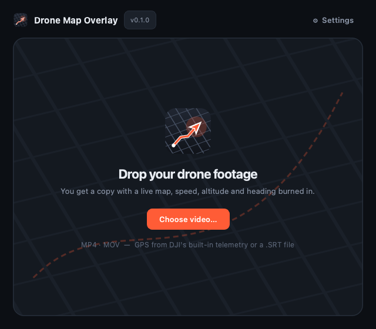

# Drone Map Overlay

Drop in a drone video, get back a copy with a **live map** and **flight stats**
(speed, altitude, heading, distance, coordinates) burned in. Works on Windows,
macOS and Linux.




## Features

- **No extra files needed for recent DJI drones.** GPS is read from the telemetry DJI
  embeds inside the MP4 (tested on the Mini 5 Pro). Older DJI drones work too if you
  recorded with **Video Subtitles / Captions** turned on (the `.SRT` file next to the video).
- **Live mini-map** that follows the drone: path flown, camera direction, north marker,
  north-up or direction-of-flight-up, standard / grayscale / dark map styles.
- **Flight stats panel** with metric or imperial units.
- **Layout editor:** drag and resize the map and stats directly on a frame of your own
  video, scrub through time, pick an accent colour. Layout is stored relative to the
  frame, so it fits any resolution or aspect ratio.
- **Keeps your quality:** 10-bit HEVC in, 10-bit HEVC out at the original bitrate
  (or H.264 for maximum compatibility). Audio is copied as-is.
- Drop several videos (or a whole folder) to queue them.

## Download

Builds for each platform are produced by GitHub Actions on every push
(**Actions → latest run → Artifacts**) and attached to tagged releases.

- **macOS:** the app isn't signed yet. The first time, right-click the app → **Open** → **Open**.
- **Windows:** SmartScreen may warn about an unknown publisher → **More info** → **Run anyway**.
- **Linux:** extract the `.tar.gz` and run `Drone Map Overlay/Drone Map Overlay`.

## How to use

1. Open the app and drop a video onto the window (or click **Choose video…**).
2. The finished copy is saved next to the original as `NAME_map.mp4`
   (change the folder and file name ending in **Settings → Output**).
3. Click **Settings** to change what's shown and to move or resize the map and stats.

### Command line

```bash
dronemap VIDEO.MP4                 # render with your saved settings
dronemap *.MP4                     # several at once
dronemap VIDEO.MP4 --preview 12    # PNG of the frame at 12 s, to check the look
dronemap VIDEO.MP4 --settings my-layout.json -o out.mp4
```

In the packaged app, use `"Drone Map Overlay" --cli ...` with the same options.

## Speed and hardware

- On macOS, encoding uses the hardware video encoder (VideoToolbox). A 16 s 4K/60 clip
  renders in roughly 35 s on Apple Silicon.
- On Windows and Linux, encoding runs on the CPU (x265 / x264), so 4K takes longer.
- Decoding and drawing the overlay run on the CPU on all platforms.

## Map data and privacy

Map tiles come from [OpenStreetMap](https://www.openstreetmap.org/copyright). They are
downloaded once for the area you flew and cached on your computer, which means
OpenStreetMap's tile server sees which area you requested. OpenStreetMap's licence asks
for credit when you publish a map: either turn on **Map credit** in Settings or add
"Map data © OpenStreetMap contributors" to your video description.

The tile server can be changed in the settings file (`tiles.url`), for example to use your
own tile server. Please respect the
[OSM tile usage policy](https://operations.osmfoundation.org/policies/tiles/) for heavy use.

## Building from source

Python 3.9+:

```bash
python -m venv .venv
.venv/bin/pip install -e ".[dev]"
.venv/bin/python -m pytest                      # tests (offline)
.venv/bin/drone-map-overlay                     # run the app
.venv/bin/pyinstaller packaging/dronemap.spec   # build the app into dist/
```

Project layout:

| Path | What it does |
| --- | --- |
| `src/dronemap/telemetry.py` | Reads GPS from DJI's embedded `djmd` protobuf track or an `.SRT` file |
| `src/dronemap/tiles.py` | Downloads, caches and stitches map tiles |
| `src/dronemap/render.py` | Draws the map and stats widgets |
| `src/dronemap/encode.py` | Decode → overlay → encode pipeline (PyAV / FFmpeg) |
| `src/dronemap/gui.py`, `theme.py` | The desktop app (PySide6) |
| `src/dronemap/settings.py` | Settings and where they're stored |
| `packaging/` | App build spec, icon generator, test-video generator |

### Adding another drone

`telemetry._decode_djmd_frame` knows the field layout used by the Mini 5 Pro and falls back
to searching each packet for a latitude/longitude pair. If your drone's video isn't
recognised, open an issue with a short sample clip.

## License

Not chosen yet.
